# ELEC 402 - Project 2: Pipelined Multiplier with Fill/Drain Buffer

**Due:** November 15th, 11:59 PM - **Optional midpoint check:** November 3rd, 11:59 PM - **Weight:** 20%

---

## Introduction

Hardware that produces data rarely runs in step with the hardware that consumes it. A DSP block might generate a batch of results, and then a DMA engine or bus master picks them up later, all at once, whenever it gets a turn. The usual fix is to put a buffer between the two: the producer fills it, and once it is full the consumer drains it. That way neither side needs to know the other's exact timing.

This project is a small version of that setup. You will build a datapath that has to close timing at high clock frequencies (the pipelined multiplier) and the control logic that keeps the buffer safe (occupancy tracking, a fill phase and a drain phase). You will then take both through synthesis and gate-level simulation and see what it costs in area, power, and slack to go from 400 MHz to 800 MHz.

You will implement `mkMultBuff` in SystemVerilog: a **16-bit signed (two's-complement) pipelined multiplier** whose products are stored in a **64-entry memory**.

Operand pairs go in during the **fill** phase. Each pair passes through the multiplier, and its product is written to the next free slot in memory. Once all 64 slots are full, the **drain** phase reads every product back out, in the same order it was produced.

**Fill, then drain.** The flow is always the same shape:

- During **fill**, each accepted multiply (when `EN_mult` and `RDY_mult` are both valid) sends one operand pair into the pipeline. Its product lands in memory a few cycles later. `RDY_mult` stays high until the memory is (or is about to become) full.
- When 64 products are stored, the memory is **full**. `RDY_mult` is low, so no more multiplies are accepted, and `RDY_blockRead` rises.
- During **drain**, each accepted read (when `EN_blockRead` and `RDY_blockRead` are both valid) reads the next entry, and `VALID_memVal` pulses with its product one cycle later. The memory can be read **only after it is full**.
- After the 64th read `RDY_blockRead` drops, the memory is empty, and `RDY_mult` rises again, ready for the next fill.

The data moves one value per handshake: each accepted write sends one operand pair, and each accepted read returns one product. `EN_mult` and `EN_blockRead` are valid signals - either side may drop its enable at any time, which simply **pauses** the fill or the drain until the enable returns. The 64 multiplies and the 64 reads need not be back-to-back.

Reads and writes **never overlap**: the memory is drained only after it is full (no writes are accepted during a drain), so `EN_writeMem` and `EN_readMem` are never high in the same cycle.

You submit two independent implementations:

| Folder | Target | Minimum stages |
|--------|--------|----------------|
| `submission/rtl_400/` | 400 MHz | 2 |
| `submission/rtl_800/` | 800 MHz | Your choice |

Both implementations share the same `mkMultBuff` top-level interface. Every `.sv` file in each folder is compiled automatically, so extra sub-modules go in the same folder.

Synthesis uses **Cadence Genus 20.10** on **GPDK 45 nm**. Gate-level simulation uses **QuestaSim 2022.1**. The provided `bob.py` script runs both tools and sources the CMC tool paths for you.

---

## Module interface

The starter skeleton is in `starter/rtl/mkMultBuff.sv`. Copy it to both submission folders and implement it there. The port list below is the **complete** interface.

```Verilog
module mkMultBuff #(parameter int N = 32) (
    input logic clk,
    input logic RST_N, // active-low synchronous reset

    // Multiplier / write side
    input logic EN_mult, // user: has a pair of operands to multiply
    input logic [15:0] mult_input0, // signed operand A (two's complement)
    input logic [15:0] mult_input1, // signed operand B (two's complement)
    output logic RDY_mult, // module: multiplier is ready to receive a pair

    // Read / drain side
    input logic EN_blockRead, // user: wants to read a value out
    output logic RDY_blockRead, // module: a value is ready to be read
    output logic VALID_memVal, // 1 the cycle memVal_data is valid
    output logic [N-1:0] memVal_data, // signed product read from memory

    // Memory ports -- the TESTBENCH connects these to memory_wrapper_2port.
    // Do NOT instantiate the memory inside mkMultBuff.
    output logic EN_writeMem,
    output logic [5:0] writeMem_addr,
    output logic [N-1:0] writeMem_val,

    output logic EN_readMem,
    output logic [5:0] readMem_addr,
    input logic [N-1:0] readMem_val
);
```

### Signal summary

**Write side - data**

| Signal | Description |
|--------|-------------|
| `EN_mult` | Input from the user (the producer): high when it has a pair of operands to be multiplied. |
| `RDY_mult` | Output from the module: high when the multiplier is ready to receive a pair. |
| `mult_input0`, `mult_input1` | Signed 16-bit operands. A multiply is accepted when `EN_mult` and `RDY_mult` are both valid. |

**Read side - data**

| Signal | Description |
|--------|-------------|
| `EN_blockRead` | Input from the user (the consumer): high when it wants to read a value out. |
| `RDY_blockRead` | Output from the module: high when a value is ready to be read, from the moment the memory is full until the 64th read is accepted. A read is accepted when `EN_blockRead` and `RDY_blockRead` are both valid, and each accepted read reads the next entry. |
| `VALID_memVal` / `memVal_data` | A drained product is valid exactly 1 cycle after its address is presented to the memory (the memory's one-cycle read latency). |

**Memory ports**

| Signal | Description |
|--------|-------------|
| `EN_writeMem`, `writeMem_addr`, `writeMem_val` | Write port: a landed product is written to the next free slot. |
| `EN_readMem`, `readMem_addr`, `readMem_val` | Read port: each accepted read presents the next address (0..63 in order), and `readMem_val` returns the data one cycle later. |

---

## Design requirements

### 1. Pipelined multiplier

Each accepted write computes the **signed** 16x16 two's-complement product of `mult_input0` and `mult_input1`. The multiplier must be pipelined so that a new operand pair can be accepted every cycle. Every accepted pair produces exactly one memory write, in the order the pairs were accepted.

Any pipeline depth is acceptable as long as:
- `EN_writeMem` is aligned with `writeMem_val`, whatever the depth: the write enable must leave the pipeline on the same cycle as its product.
- Timing closure is achieved (WNS >= 0 ps) at the target frequency.

#### Two's complement

The operands and the product are **signed two's-complement** numbers. In an `n`-bit two's-complement number, the top bit has weight `-2^(n-1)` and the rest have the usual positive weights, so a 16-bit value represents the range `-32768 .. +32767`:

```
 0000_0000_0000_0001 =  +1
 0000_0000_0000_0000 =   0
 1111_1111_1111_1111 =  -1      (all ones)
 1000_0000_0000_0000 = -32768   (most negative)
 0111_1111_1111_1111 = +32767   (most positive)
```

Negate with `-x = ~x + 1`. Add/subtract use the same adder as unsigned. A signed `16x16` product ranges from `-32768 * 32767` to `+2^30`, so it fits in **32 bits** (`N = 32`).

### 2. The 64-entry memory

> **Do not instantiate `memory_wrapper_2port` inside `mkMultBuff`.** The memory is part of the testbench, not your design. The testbench instantiates it and connects it to your memory ports. Your module only drives and reads those ports. A memory inside `mkMultBuff` would be synthesized into your design and break the flow (and the area numbers).

Products are stored in the provided 64-entry memory (`memory_wrapper_2port`) and read back in the order they were written (FIFO). The write port (B) is a simple synchronous write, and the read port (A) is a synchronous read - `readMem_val` comes back **one cycle after** you present `readMem_addr` with `EN_readMem` high. That one-cycle latency is exactly the `VALID_memVal` timing, so do not add another register on `memVal_data`.

### 3. Fill phase (`RDY_mult`)

Multiplies are accepted whenever `EN_mult` and `RDY_mult` are both valid. `EN_mult` is a user signal: the producer may drop it at any time, which simply **pauses** the fill (no accepted write is lost) and it resumes when `EN_mult` returns.

`RDY_mult` is high while the memory can still take another product **and** no drain is in progress. It must account for products still in the multiplier pipeline: do not accept a multiply whose product would have nowhere to land once it exits the pipeline.

Once 64 products have landed, the memory is **full** and `RDY_mult` stays low until the memory has been fully drained.

### 4. Drain phase (`RDY_blockRead`, `EN_blockRead`, `VALID_memVal`)

The memory may be read **only after it is full**. `RDY_blockRead` rises once the 64th product has landed, and stays high until all 64 entries have been read. Reads are accepted whenever `EN_blockRead` and `RDY_blockRead` are both valid. Each accepted read presents the next address (0, 1, 2, ..., 63) on the read port with `EN_readMem` high. Because the memory read port is registered, `VALID_memVal` pulses (and `memVal_data` is valid) exactly one cycle after each address is presented.

`EN_blockRead` is a valid signal, just like `EN_mult`: the consumer may drop it at any time, which simply **pauses** the drain, and it resumes from the next address when `EN_blockRead` returns. `EN_blockRead` is ignored while `RDY_blockRead` is low.

While a drain is in progress, `RDY_mult` is low - no multiplies are accepted, so the memory is never read and written in the same cycle. When the 64th read is accepted, `RDY_blockRead` drops, the memory is empty, and `RDY_mult` rises again.

### 5. Reset

`RST_N = 0` (synchronous, active low) returns the module to its empty, idle condition: nothing in flight, nothing stored, not draining, `RDY_mult` high, `RDY_blockRead` low. Use a synchronous reset on **every** register in the module.

---

## Timing diagrams

> All diagrams show a **2-stage pipeline** as an example. Your implementation may use more stages. The checker testbench waits on the handshake/valid signals, so it works with any pipeline depth.

### 1. Fill - products land in memory

A multiply is accepted when `EN_mult` and `RDY_mult` are both valid. `EN_writeMem` fires a few cycles later when the valid bit exits the last pipeline stage, and `writeMem_addr` walks up 0, 1, 2, ...

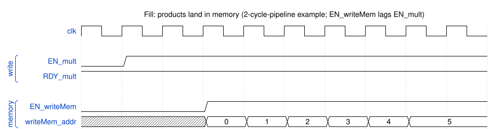

### 2. Full - `RDY_mult` drops, `RDY_blockRead` rises

`RDY_mult` goes low as soon as the products still in the pipeline will fill the memory. Once the 64th product has been stored (`writeMem_addr` reaches 63), the memory is full and `RDY_blockRead` goes high. No further multiplies are accepted until the memory has been drained.

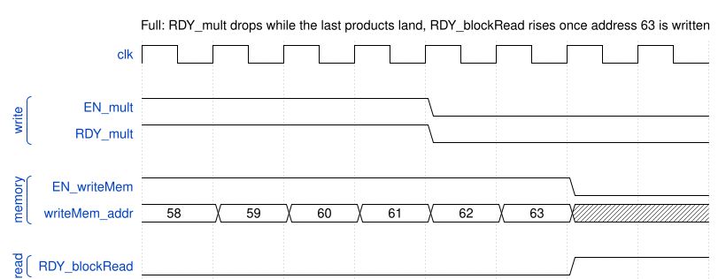

### 3. Drain - sequential read-out

Each cycle where `EN_blockRead` and `RDY_blockRead` are both valid reads one entry. `EN_readMem` goes high and `readMem_addr` walks 0, 1, 2, and so on. `VALID_memVal` and valid `memVal_data` appear exactly **one cycle later** for each address.

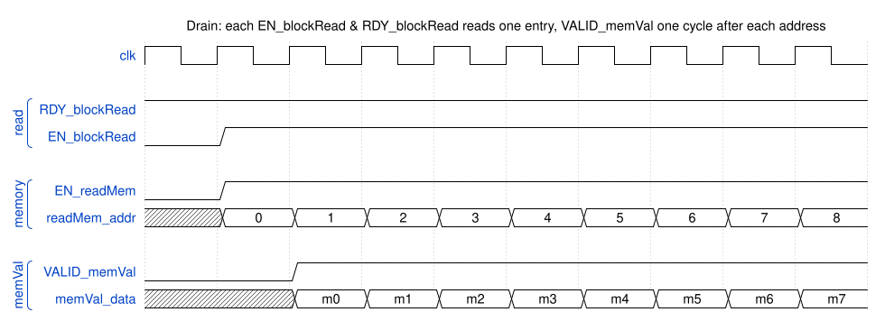

### 4. End of drain - memory empties

After address 63 is presented, `RDY_blockRead` drops, the last `VALID_memVal` pulse returns its data, the memory is empty, and `RDY_mult` rises again for the next fill.

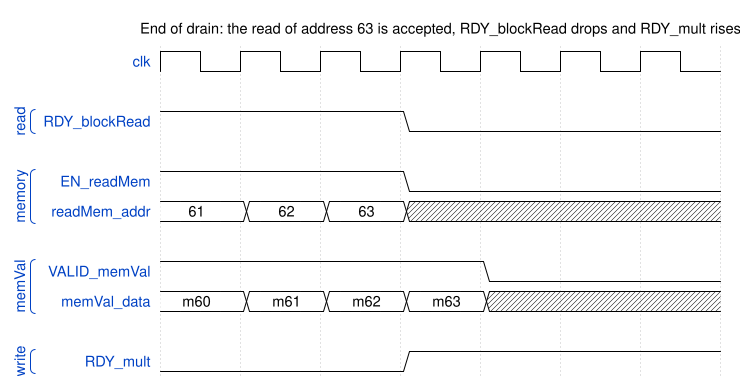

---

## Walkthrough: one full run from reset

Now that each signal has been introduced, here is one complete run put together. The shape is always the same - **fill to 64, then drain all 64** - and then it repeats. The waveforms use a 2-stage pipeline as an example. A deeper pipeline only makes the products land later.

### Step 1 - Reset

`RST_N` is asserted first thing, before anything else happens. While it is low every output sits at its idle value: `RDY_mult` is 1, and `EN_writeMem`, `writeMem_addr`, `RDY_blockRead`, `EN_readMem` and `VALID_memVal` are all 0. Once `RST_N` goes high the first multiply can be accepted, and its product is written to address 0.

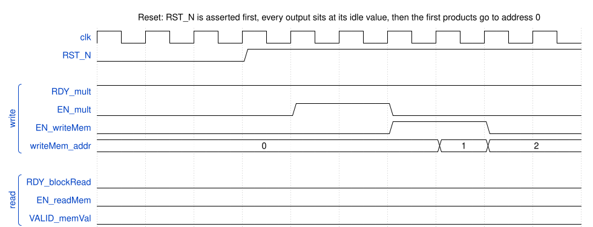

### Step 2 - Fill

The producer raises `EN_mult` with operand pairs on `mult_input0` and `mult_input1`. Each pair is accepted when `EN_mult` and `RDY_mult` are both valid, and goes into the multiplier pipeline. When its product comes out the other end, `EN_writeMem` goes high with the product on `writeMem_val`, and `writeMem_addr` moves to the next slot.

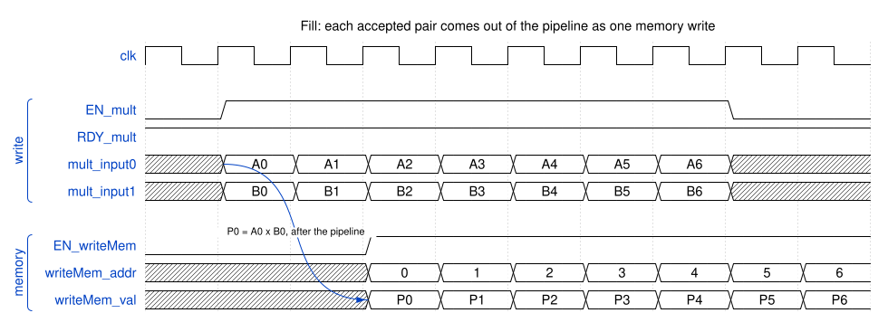

### Step 3 - Pausing the fill

The producer can drop `EN_mult` at any time. Nothing is accepted while it is low, so the same gap shows up in the writes once the pipeline catches up. The address simply continues from where it stopped, so no slot is skipped.

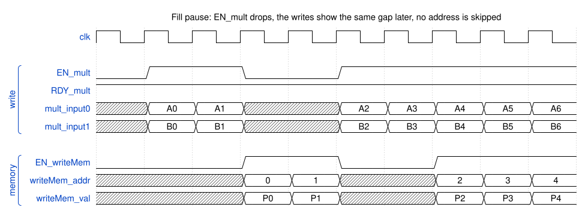

### Step 4 - Full, then the switch to reading

`RDY_mult` counts the products still in the pipeline, not only the ones already in memory. It drops as soon as those products are enough to fill all 64 slots, so the producer can keep `EN_mult` high and nothing more is accepted. The last products keep landing, and the final one goes to address 63.

Once that write is done the memory is full, and `RDY_blockRead` rises. In this example the consumer already has `EN_blockRead` high, so the first read of address 0 happens right away, and its product comes out on `memVal_data` one cycle later. If `EN_blockRead` were low, the module would simply wait, full, until it goes high.

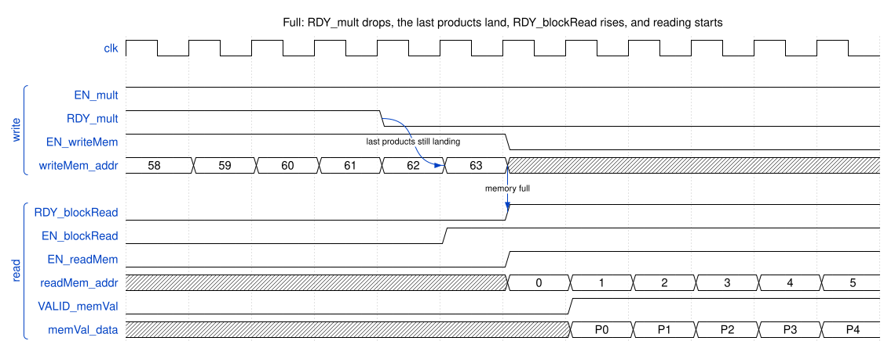

### Step 5 - Drain

Each cycle where `EN_blockRead` and `RDY_blockRead` are both valid reads one entry. `EN_readMem` goes high and `readMem_addr` counts up from 0. The memory returns each value one cycle later, and that is when `VALID_memVal` is high with the product on `memVal_data`. The products come out in the same order they went in.

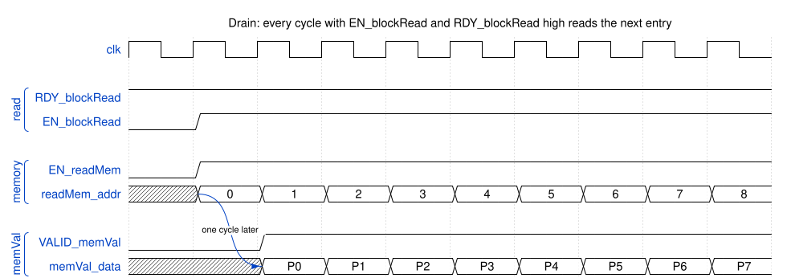

### Step 6 - Pausing the drain

The consumer can drop `EN_blockRead` at any time, just like the producer can drop `EN_mult`. Nothing is read while it is low, so `VALID_memVal` shows the same gap one cycle later. When `EN_blockRead` returns, reading continues from the next address.

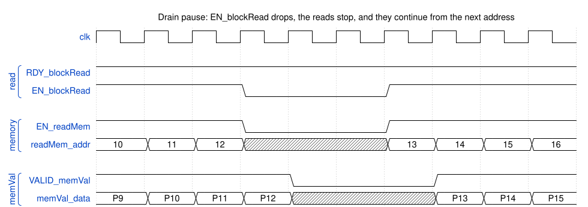

### Step 7 - Empty, then repeat

When the read of address 63 is accepted, `RDY_blockRead` drops and the last product comes out on `memVal_data` one cycle later. The memory is now empty, so `RDY_mult` rises again. The next fill starts writing at address 0, and the whole run repeats.

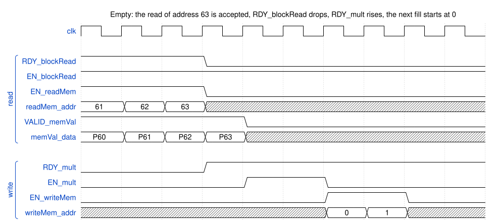

### What this shows

- The multiply pipeline can be any depth. The control tracks in-flight products with the multiplier's `valid` output and never overruns the memory.
- Writes **fill** the memory to 64 before any read happens, and reads then **drain** all 64.
- Reads and writes **never overlap** - `RDY_blockRead` and `RDY_mult` are never high at the same time.
- The memory read port's one-cycle latency is exactly the `VALID_memVal` timing.

---

## Synthesis

### What you need to do

Do this once for each target (400 MHz from `rtl_400/`, 800 MHz from `rtl_800/`):

1. **Copy the script template.** `starter/scripts/synth.tcl` handles file reading, report names and output files. The clock, the constraints, the synthesis steps and the `synth_run` calls are left for you. Copy it into your submission and edit the copy:

   ```bash
   cp starter/scripts/synth.tcl submission/scripts/synth.tcl
   ```

2. **Create the clock and apply the constraints** below in TODO 1-3 of `submission/scripts/synth.tcl`.
3. **Write the synthesis steps** in TODO 4: map the design to gates, run the incremental optimization passes, and enable retiming so Genus can move registers across logic to balance your pipeline. Then set the **reporting clock** in TODO 5.
4. **Add the rest of the arguments of `synth_run`** in TODO 0, then **call it** for each target in TODO 6. Its `tag` argument is the target frequency, `400` or `800`, and names the output files. `bob.py` sets `RUN_TAG` and then runs the script, so work out how your calls should use it.
5. **Synthesize:** `python3 bob.py synth --run 400` and `python3 bob.py synth --run 800`. Reports go to `submission/syn_reports/`, the netlist, SDF, SDC and Genus database to `submission/outputs/`. Both folders are part of your submission.
6. **Check the reports.** The timing report must show no negative slack (WNS >= 0 ps) at the target period: 2.5 ns for 400 MHz, 1.25 ns for 800 MHz. If it does not, change your RTL or your synthesis settings and synthesize again.
7. **Check the netlist** with the SDF testbench: `python3 bob.py timing --run 400` and `--run 800`. X values on `memVal_data` mean a setup or hold violation.

### Constraints

Apply these in TODO 1-3, after creating the clock:

- Input-to-flop and flop-to-output paths may consume the full clock period (i.e., set input and output delays to 0).
- Assume minimum-sized D flip-flops drive all inputs. Transition time = 1/8 clock period.
- All outputs drive 4x the capacitance of pin A of NAND2X4.
- Do **not** synthesize `memory_wrapper_2port`. Only `mkMultBuff` and its sub-modules are synthesized, which is why the memory must stay in the testbench (see Design requirements, section 2).

Reports are always checked at the target period (2.5 ns and 1.25 ns). In TODO 6 you may synthesize with a slightly tighter period to leave some margin.

### Tips and tricks

A few things to try when 800 MHz timing is close:

- **Barely missing setup (a few ps):** synthesize against a tighter clock than you report at - synthesize at a lower period (e.g. 1.15 ns) while keeping the reporting clock at 1.25 ns (TODO 5 and 6). The extra margin often flips the reported slack positive.
- **Negative but close (around -20 ps):** turn on **retiming** so Genus rebalances your pipeline stages (it moves registers through the logic without changing your latency or port behaviour). After `elaborate` and before `synthesize`, add `set_db design:$cur .retime true` - wrap it in `if {$tag eq "800"} { ... }` to apply it only at 800 MHz.
- **Still short:** raise the synthesis `effort` (low -> medium -> high).

### 400 MHz target (2.5 ns clock)

A 2-3 stage pipeline is sufficient for most straightforward implementations. Run `report_timing` after synthesis and inspect the critical path. Area target: < 6 000 um^2.

### 800 MHz target (1.25 ns clock)

A shallow pipeline is unlikely to close timing at 1.25 ns. Expect to:

- Add more pipeline stages to the multiplier (the critical path is almost certainly through the multiplier tree).
- Raise the synthesis effort (TODO 6) and, if your stages are unbalanced, turn on retiming (see Tips and tricks above).
- Inspect the timing report to find any remaining critical paths. A long carry chain in the multiplier or in the occupancy tracking can become the new bottleneck once the multiplier is broken up.

Area target: < 12 000 um^2.

---

## Testbench requirements

Copy the three templates from `starter/tb/` into `submission/testbench/` and fill in your tests. Each template has clearly marked `TODO` sections.

### `rtl_checker.sv` - top module: `mkMultBuff_tb`

Functional RTL simulation. Your testbench must cover:

- At least **8 memory fills** (fill all 64, drain all 64, repeat)
- Signed boundary inputs: `-32768 * -32768`, `-1 * 1`, `0 * 32767`, `32767 * 32767`, `-1 * -1`
- Reads only after the memory is full (`RDY_blockRead` high), and the full 64-entry sequential drain
- Pauses on both sides: drop `EN_mult` in the middle of a fill and `EN_blockRead` in the middle of a drain
- `EN_writeMem` and `EN_readMem` never high in the same cycle
- `RDY_mult` low while full / draining, and high again after a complete drain
- `RDY_blockRead` low during the fill, high once full, and low again after the 64th read
- A scoreboard that checks every product read out of memory against the expected signed product

> **All operand values must be random.** Drive `mult_input0`/`mult_input1` from a random source (e.g. `$urandom`) - do not hard-code or march through fixed patterns (other than the required signed boundary cases above). Fixed patterns can hide carry/sign bugs that random stimulus exposes.

### `sdf_checker_400.sv` - top module: `mkMultBuff_sdf_checker_400`

Gate-level simulation at **400 MHz** (2.5 ns clock, fixed - do not change). `bob.py` passes the SDF file via `+sdf_file=...`. An X on `memVal_data` after `VALID_memVal` means a setup or hold violation in your netlist - fix the RTL and re-synthesize.

> **Your SDF checker must distinguish a design that meets timing from one that does not.** When the back-annotated netlist has a setup/hold violation, the gate-level sim drives `X` onto the data. Your checker **must fail** in that case. A checker that passes regardless of timing earns no credit. Use random operands here too. Keep the count moderate (gate sim is ~10x slower than RTL - a few fills is enough).

> **Tip:** launch (drive) your inputs on the rising edge, but sample the outputs on the falling edge instead of the rising edge.

### `sdf_checker_800.sv` - top module: `mkMultBuff_sdf_checker_800`

Same as above at **800 MHz** (1.25 ns clock, fixed), with the same pass/fail requirement.

> The grader runs its own checker against your netlists. Your testbench grade is proportional to how many outputs your design produces correctly. Make it thorough.

---

## Provided files

**Copy these into `submission/` and edit your copies** - this is the work you hand in:

| File | What it is | What you do |
|------|-----------|-------------|
| `starter/rtl/mkMultBuff.sv` | Interface skeleton (ports only) | Copy to **`submission/rtl_400/`** and **`submission/rtl_800/`**, then implement it in each |
| `starter/scripts/synth.tcl` | Genus synthesis template | Copy to **`submission/scripts/`** and fill in the TODOs |
| `starter/tb/rtl_checker.sv` | RTL testbench template (top `mkMultBuff_tb`) | Copy to **`submission/testbench/`** and write your tests |
| `starter/tb/sdf_checker_400.sv` | SDF testbench template, 400 MHz | Copy to **`submission/testbench/`** and write your tests |
| `starter/tb/sdf_checker_800.sv` | SDF testbench template, 800 MHz | Copy to **`submission/testbench/`** and write your tests |

**Leave these in `starter/` - do not copy or edit them.** `bob.py` compiles and calls them from where they are:

| File | What it is |
|------|-----------|
| `starter/rtl/memory_wrapper_2port.sv` | 2-port synchronous SRAM wrapper (64 x N bits), the testbench's memory |
| `starter/rtl/registerArray.sv` | Register array used by the memory wrapper |
| `starter/scripts/saif2power.tcl` | Post-synthesis power report script |
| `starter/scripts/vcd2saif_run.csh` | VCD to SAIF conversion |

---

## Submission layout

```
submission/
  rtl_400/
    mkMultBuff.sv          400 MHz implementation
    [sub-modules.sv ...]
  rtl_800/
    mkMultBuff.sv          800 MHz implementation
    [sub-modules.sv ...]
  scripts/
    synth.tcl              your copy of starter/scripts/synth.tcl, TODOs filled in
  testbench/
    rtl_checker.sv         top: mkMultBuff_tb
    sdf_checker_400.sv     top: mkMultBuff_sdf_checker_400
    sdf_checker_800.sv     top: mkMultBuff_sdf_checker_800
  syn_reports/             populated by bob.py synth
    *.rpt
  outputs/                 populated by bob.py synth (netlist, SDF, SDC, Genus .dat)
    mkMultBuff_{400,800}_map.sv / .sdf / .sdc
    mkMultBuff_synth_{400,800}.dat
  pdf_report/
    report.pdf             your writeup (see Grading > Report)
```

---

## Running the flow with `bob.py`

Run all commands from the project root on `ssh-soc.ece.ubc.ca`. CMC tool paths are sourced automatically - no manual `source` required.

```bash
# Step 1: synthesize
python3 bob.py synth --run 400
python3 bob.py synth --run 800

# Step 2: RTL functional check (runs your rtl_checker.sv)
python3 bob.py check --run 400
python3 bob.py check --run 800

# Step 3: gate-level sim for power (generates VCD)
python3 bob.py sim --run 400
python3 bob.py sim --run 800

# Step 4: SDF timing check (gate-level with back-annotated delays)
python3 bob.py timing --run 400
python3 bob.py timing --run 800

# Step 5: power analysis (VCD -> SAIF -> report)
python3 bob.py power --run 400
python3 bob.py power --run 800
```

Reports land in `submission/syn_reports/`, netlists, SDF and the other synthesis outputs in `submission/outputs/`. Synthesis logs in `submission/syn_logs/`.

---

## Submitting

### Repository setup

**We create your repository for you. Do not create one yourself.**

1. **Fill in the Google Form posted on Piazza** with your name, student number and GitHub username.
2. The teaching staff create a **private** repository for you in the course organization, named **`elec402-p2-2026-<firstname><lastname>`** (all lowercase, for example `elec402-p2-2026-aliabedian`), and give your GitHub account write access to it.
3. Accept the GitHub invitation if you get one (check your email or `github.com/ubc-elec402-2026`). Then clone your repository and work in it:

   ```bash
   git clone git@github.com:ubc-elec402-2026/elec402-p2-2026-<firstname><lastname>.git
   ```

Your repository already contains the starter files. Only the teaching staff can change its settings, so it always stays private. Do not make a copy of it in your personal account or anywhere outside the course organization. Only the repository we create is graded.

#### Starting early from the zip

If your repository has not been created yet, we may give you the starter files as a **zip** so you can start early. Unzip it and work in that folder as usual.

Once your repository exists, connect that folder to it. Run these commands inside the unzipped folder. Your files are kept, and your work is added on top of the starter files already in your repository:

```bash
git init -b main
git remote add origin git@github.com:ubc-elec402-2026/elec402-p2-2026-<firstname><lastname>.git
git fetch origin
git reset origin/main
git branch --set-upstream-to=origin/main
git add -A
git commit -m "Add my early work"
git push
```

`git reset origin/main` only takes over the repository's history. It does not change any file in your folder. After this, keep working in that folder and run the `submit.py` commands below from there.

### Tagging your submission

```bash
# Run once when you start -- records your start timestamp
python3 submit.py start

# Optional, no-marks midpoint check -- tag it by 11:59 PM on November 3rd
python3 submit.py midpoint

# Run when ready to submit (re-running before the deadline overwrites the tag)
python3 submit.py finish
```

Each command stages your work, commits it as `Project-2-ELEC402: START` / `MIDPOINT` / `FINISH`, and pushes the matching tag. The version tagged **FINISH** at the deadline is what gets graded.

**MIDPOINT is optional and costs no marks.** If you tag it by 11:59 PM on November 3rd, we run the testbench against your RTL and send back which test cases are failing, as free feedback -- nothing is deducted for whatever we find.

---

## Grading

| Component | Marks |
|-----------|-------|
| RTL functional correctness (grader testbench, proportional to correct outputs) | 40 |
| Synthesis 400 MHz - timing | 10 |
| Synthesis 400 MHz - area < 6 000 um^2 | 5 |
| Synthesis 800 MHz - timing | 10 |
| Synthesis 800 MHz - area < 12 000 um^2 | 5 |
| SDF gate-level timing check 400 MHz | 10 |
| SDF gate-level timing check 800 MHz | 10 |
| Power analysis (VCD-based report) | 5 |
| Report (required) | 5 |
| **Total** | **100** |

Each component is expanded below.

### RTL functional correctness (40)

We run **our own** checker against your `submission/rtl_400/` and `submission/rtl_800/` designs. The mark is proportional to how many outputs your design produces correctly, so partial credit is possible. Your own testbenches are not what earns these marks - they are graded separately under the report and are there to help you find your own bugs.

### Synthesis timing (10 per frequency)

Earned from the worst-case slack (WNS) in `report_timing` at the target period.

| Slack (WNS) | Marks |
|-------------|-------|
| VIOLATED (WNS < 0) | 0 |
| MET, 0 ps <= WNS < 5 ps | 6 |
| MET, 5 ps <= WNS < 5% of the clock period | 7 |
| MET, WNS >= 5% of the clock period | 10 |

So **just meeting timing (0 ps slack) is fine** and earns 6/10, and at least 5 ps of slack earns 7/10. The last 3 marks are for leaving at least 5% of the clock period as slack - **>= 125 ps at 400 MHz** (2.5 ns period) and **>= 62 ps at 800 MHz** (1.25 ns period). That extra slack is for place and route in Project 3, so keep it in mind now: real wires add delay once the design is laid out, and starting with margin makes that step much easier.

### Area (5 per frequency)

The 5 marks are for coming in under the area budget (from `report_area`): **6 000 um^2** at 400 MHz and **12 000 um^2** at 800 MHz. Among designs that meet both timing and their area budget, the class may then be curved, by a reduction determined later (which may or may not be similar to how Assignment 1 was graded) - a smaller area scores higher.

### SDF gate-level timing (10 per frequency)

We run your `submission/testbench/sdf_checker_400.sv` / `sdf_checker_800.sv` in ModelSim with the SDF delays back-annotated, against **your own** synthesized netlist and also against **our own implementations, including ones with incorrect or failing timing**. It is a **requirement** that your checker fails on a netlist with incorrect timing, and it must pass a netlist that meets timing, so it has to actually exercise the design and catch violations - any X on `memVal_data` after `VALID_memVal` is a setup or hold violation. The mark is proportional to how many of these test cases your checker gets right (passes the good netlists, fails the bad ones).

> **Hint:** sample (look at) your outputs on `negedge`, so you read values that have already settled rather than catching them right at the clock edge. Drive your inputs a full cycle ahead - not on the negedge - so input-to-flop paths get the whole period (that is what the `input_delay 0` constraint assumes).

### Power (5)

From the VCD-based power report (`bob.py power`). May be curved against the rest of the class, by a reduction determined later (which may or may not be similar to how Assignment 1 was graded) - lower power at a given frequency scores higher. In your testbenches, keep `EN_mult` high for 64 cycles to measure average multiplier power, and measure read-memory power while draining for 64 cycles.

### Report (5, required)

Put your report in **`submission/pdf_report/`** as a PDF named **`report.pdf`** (the `.rpt` synthesis reports stay in `submission/syn_reports/`). It is **required**: a submission with no `report.pdf` is incomplete. *Note: the report format may change from `report.pdf` to a README (to be determined later). We will announce it if it does.* It must include:

1. Name, student number, project title
2. Synthesized area and power (initial estimate + VCD-based) for both 400 MHz and 800 MHz
3. **Design decisions section**: pipeline depth chosen, critical path identified at each frequency, and at least one RTL or synthesis change made to meet the 800 MHz target
4. **Diagrams**: a state diagram for every state machine you implement, and a datapath/pipeline diagram - if you pipeline the design, the diagram must show each pipeline stage and the registers between them
5. SystemVerilog code listing (appendix is fine)
6. **Testbench description** with representative waveforms. Describe what each checker tests and how, and show the differences between your RTL checker and your SDF checkers, using waveforms from each. Point out any glitches, X values or delayed outputs that only appear in the SDF (gate-level) simulation.
7. Comparison of RTL vs gate-level waveforms - note the clock-to-output delays and any transient glitches on `RDY_mult` in the synthesized netlist
8. AI-use statement

---

## Academic misconduct

This is an individual project. The work you submit must be your own.

- You may not copy another student's code or collaborate on your implementation. Do not share your code, your testbenches, or your report with anyone, and do not look at anyone else's.
- Any Piazza post that contains code, parts of a solution, or details of your implementation must be **private** (visible only to the instructors). Keep public posts to general, non-solution questions.
- Editing your reports or results to make a design look like it passes when it does not - for example, doctoring the synthesis reports, the timing numbers, or the testbench output - is cheating and may result in a grade of **0** on the project.
- You must disclose any AI use in the AI-use statement in your report. Failing to list it is treated the same as the above and may result in a grade of **0**.

Suspected misconduct will be reported to the department and handled under UBC's academic integrity policy. You are of course encouraged to use the course material, discuss concepts at a high level, and ask the teaching staff when you are stuck.

### Same Note as Project 1 on use of AI and autonomous agents

AI/LLM tools may be used as learning and debugging aids. For example, you may ask an AI system to explain concepts, SystemVerilog or TCL syntax, CAD-tool error messages, timing reports, or to suggest debugging approaches and test cases.

You may not delegate completion of a project to an autonomous agent. In particular, you may not give an AI agent the project directory and instruct it to create or modify the design, run the CAD tools, iteratively debug the design, or generate the final project deliverables on your behalf.

You remain responsible for the design and for every submitted file. You must be able to explain your schematic, RTL, testbench, scripts, design choices, and CAD results, and to reproduce a result or make a small modification if requested by the teaching staff. At the end of each report, include a brief AI-use statement identifying the tools used and how they were used. Detailed chat transcripts are not required. Any submission may be selected for a brief verification discussion or demonstration.

---

## Tips and tricks

Now that you've read all of the README, here are a few tips and tricks for the datapath.

- **Pipeline the multiplier, not the control.** The critical path is almost always through the multiplier. Register the operands at the input and the product through the stages, then lean on retiming to balance them. The control logic (pointers, occupancy, RDY) is cheap and rarely on the critical path.
- **Keep the datapath and the control separate.** The product data flows straight from the multiplier into the buffer. The write/read pointers and the occupancy tracking are a small state machine beside it. Mixing the two makes both harder to pipeline and to read.
- **The memory read already costs a cycle.** `readMem_val` comes back one cycle after you assert the read, which is exactly the `VALID_memVal` timing. Do not add another register on `memVal_data`.
- **Track what is in flight.** Count the writes that have been accepted but have not yet landed in memory, so you never overrun the buffer.
- **Get it working at 400 MHz first, then push to 800 MHz.** A correct shallow design at 400 MHz is the right starting point. Add stages and turn on retiming only when you move to the 1.25 ns clock (see the synthesis Tips and tricks).

### Resources on multipliers

Worth reading before you decide how to build and pipeline the multiplier. In particular, look at **Wallace trees** - a fast way to sum the partial products that maps well onto a pipeline.

- Binary multiplier (overview): <https://en.wikipedia.org/wiki/Binary_multiplier>
- Two's complement: <https://en.wikipedia.org/wiki/Two%27s_complement>
- Wallace tree multiplier: <https://en.wikipedia.org/wiki/Wallace_tree>
- Video walkthrough of Binary multiplier: <https://www.youtube.com/watch?v=hK1OYxYpwEc>

---

Good luck!
